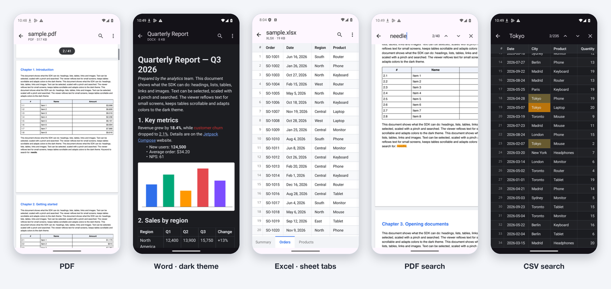

# DocxView

[](https://github.com/VolovatovTA/DocxView/actions/workflows/ci.yml)
[](https://central.sonatype.com/artifact/io.github.volovatovta.docviewer/docviewer)
[](LICENSE)
[-brightgreen.svg)](https://developer.android.com/tools/releases/platforms)
[-brightgreen.svg)](#compatibility)

View **PDF, Word (DOCX, DOC), Excel (XLSX, XLS), CSV/TSV and TXT** inside an Android app with a single component that
works the same in **Jetpack Compose** and in **XML layouts**.
No WebView, no native libraries, no Apache POI: PDF pages are drawn by the platform
`PdfRenderer`, office formats and CSV are parsed by a pure Kotlin/JVM parser.

<picture>
  <source media="(prefers-color-scheme: dark)" srcset="docs/showcase-dark.png">
  
</picture>

## Features

**PDF**
- pinch zoom up to 6×, double tap, free 2D panning with fling, Ctrl + mouse wheel on desktops/Chromebooks;
- pages stay virtualized at any zoom; when zoomed in, the visible area is re-rendered as a
  full-resolution tile so text stays sharp;
- "12 / 300" page indicator and a draggable fast-scroll thumb with a page label;
- search with highlighted matches (Android 15+, a `PdfRenderer` limitation);
- password-protected PDFs with a built-in password prompt (Android 15+);
- night mode (inverted pages).

**DOCX and DOC (Word 97–2003)**
- styles and headings, bold/italic/underline/strikethrough, colors, highlighting, font sizes,
  superscript/subscript, monospace fonts, alignment, indents;
- numbered and bulleted lists with real numbering (`1.`, `a)`, `IV.`, `а)`);
- tables with merged cells, shading and header rows; column widths follow the content,
  wide tables scroll horizontally with a fading edge;
- links (`w:hyperlink` and `HYPERLINK` fields), images (tap for fullscreen zoom),
  footnotes, page breaks, text boxes; deleted tracked changes are hidden;
- text reflows to the screen width, scales with a pinch, and can be selected and copied;
- document colors are adjusted for the dark theme, so black text never disappears.

**XLSX and XLS (Excel 97–2003)**
- every visible sheet, with tabs below the grid as in Excel; hidden sheets stay hidden;
- values shown the way Excel shows them: dates and times, currencies, percentages,
  thousands separators, scientific notation, custom number formats, both date systems
  (1900 and 1904), booleans and formula errors;
- formulas show the result Excel saved with them; search covers every sheet and switches to
  the sheet of each match.

**CSV / TSV**
- RFC 4180: quotes, line breaks inside cells, escaped `""`;
- automatic detection of the delimiter (`,` `;` `Tab` `|`), the encoding (UTF-8/16 with or
  without BOM, Windows-1251, Windows-1252) and the header row;
- pinned header and row numbers, right-aligned numbers, tap a cell to see its full text.

**Everything else**
- sources: `Uri` (content/file), `File`, assets, `ByteArray`, `InputStream`, URL with download progress;
- the format is detected from the content, not from the file extension;
- search in every format, programmatic navigation, state survives configuration changes;
- light and dark themes, fully customizable colors, English and Russian UI strings;
- dependencies: only `compose-foundation` and `compose-ui` (no Material).

## Installation

The library is published to Maven Central:

```kotlin
dependencies {
    implementation("io.github.volovatovta.docviewer:docviewer:1.1.0")
    // Parsers only, no Android: "io.github.volovatovta.docviewer:docviewer-core:1.1.0"
}
```

To build from source, run `./gradlew publishToMavenLocal` and add `mavenLocal()` to your repositories.

`minSdk 23`, `compileSdk 36`. Loading from a URL requires the `INTERNET` permission.

### Compatibility

Every API level from 23 (Android 6.0) to 37 (Android 17), including 36.1, passes the full
instrumented suite (45 tests: PDF engine stress, concurrency and UI scenarios) on emulators.

## Compose

```kotlin
@Composable
fun ReportScreen(uri: Uri) {
    val state = rememberDocumentViewerState()

    DocumentViewer(
        source = DocumentSource.uri(uri),
        state = state,
        modifier = Modifier.fillMaxSize(),
    )
}
```

Control the viewer through `state`:

```kotlin
state.search("revenue")          // highlights all matches and scrolls to the first one
state.nextSearchResult()
state.previousSearchResult()
state.goToPage(10)               // or the suspending state.scrollToPage(10)
state.zoomIn(); state.resetZoom()

state.status                     // Idle / Loading(progress) / Ready(info) / PasswordRequired / Failed
state.currentPage                // PDF page, or the first visible row/block
state.searchResultCount
state.currentSearchResult
```

Customize appearance and behavior:

```kotlin
DocumentViewer(
    source = DocumentSource.asset("contract.docx"),
    config = DocumentViewerConfig(
        maxZoom = 8f,
        textSize = 17.sp,
        pdfNightMode = true,
        csvOptions = CsvOptions(delimiter = ';', header = CsvHeaderMode.FirstRow),
    ),
    colors = DocumentViewerDefaults.lightColors(accent = Color(0xFF00A86B)),
    onLinkClick = { url -> openInCustomTab(url); true },
    // Optional custom loading, error and password screens.
    loading = { progress -> MyShimmer(progress) },
    error = { error, retry -> MyErrorState(error, retry) },
)
```

## XML

```xml
<io.github.volovatovta.docviewer.DocumentView
    android:id="@+id/documentView"
    android:layout_width="match_parent"
    android:layout_height="match_parent"
    app:dv_source="asset:///manual.pdf"
    app:dv_theme="auto"
    app:dv_accentColor="@color/brand"
    app:dv_pageSpacing="12dp"
    app:dv_maxZoom="6"
    app:dv_textSelectable="true" />
```

```kotlin
val view = findViewById<DocumentView>(R.id.documentView)
view.setUri(uri)                       // or setFile / setAsset / setUrl / source = ...
view.search("contract")
view.nextSearchResult()
view.goToPage(3)

view.setListener(object : DocumentViewListener {
    override fun onStatusChanged(status: DocumentStatus) { /* ... */ }
    override fun onPageChanged(page: Int, pageCount: Int) { /* ... */ }
    override fun onSearchResultsChanged(count: Int, current: Int) { /* ... */ }
    override fun onLinkClicked(url: String): Boolean = false
})
```

The same API works from Java: `DocumentSource.uri(uri)`, `view.setSource(...)`, and every
listener method has a default implementation. The host activity must be a `ComponentActivity`
(for example, `AppCompatActivity`). All attributes are listed in
`docviewer/src/main/res/values/attrs.xml`.

## Parsers only

The `docviewer-core` module is pure Kotlin/JVM with no Android dependencies. Use it on its own,
for example to index documents or build previews on a server:

```kotlin
val format = FormatDetector.detect(file)                    // by content, not by file name
DocumentReader.read(file).use { content ->
    when (content) {
        is DocumentContent.Flow -> FlowSearch.search(content.document, "needle")  // DOCX, DOC, TXT
        is DocumentContent.Sheets -> content.workbook.sheets.map { it.name }       // XLSX, XLS, CSV
    }
}
```

`ReadOptions(memoryBudgetBytes = ...)` refuses files that would not fit before parsing them, which
also protects a server from archives that unpack into gigabytes.

## Architecture

```
docviewer-core   format/  one reader per format, a registry that detects formats by content,
                          DocumentReader: a file in, DocumentContent (Flow or Sheets) out
                 model/   FlowDocument (paragraphs, tables, runs, images), Workbook of sheets
                 docx/ doc/          Word: WordprocessingML via SAX / OLE2 piece tables
                 sheet/xlsx/ xls/    Excel: SpreadsheetML parts / BIFF8 records; number formats
                 text/ stream/       CSV and TXT, read from disk on demand
                 ooxml/ ole/ binary/ ZIP packages, OLE2 containers, little-endian data
docviewer        DocumentViewer (Compose) and DocumentView (a View hosting ComposeView)
                 pdf/  PdfRenderer on a dedicated thread, layout, gestures, tiles, search
                 flow/ text: paragraphs, lists, tables, images
                 grid/ sheets: tabs, pinned header, search across sheets
sample           demo app: a Compose screen for every format and an XML screen
```

Every format but PDF ends up as one of two kinds of content, and each kind has one viewer.
A new format of an existing kind needs a reader in `docviewer-core` and nothing else; see
[CONTRIBUTING](CONTRIBUTING.md#adding-a-format).

## Limitations

- PDF search and password-protected PDFs require Android 15+ (older `PdfRenderer` supports
  neither; such documents still open, or fail with a clear message if they need a password).
- Text selection in PDF is not supported.
- DOC/DOCX: headers and footers, comments, OMML equations (shown as plain text), text wrapping
  and floating shapes are not reproduced; EMF/WMF images are shown as placeholders.
  Password-protected Word documents are not supported and fail with a clear message.
- Word 6.0/95 documents open as plain text; Excel 5.0/95 workbooks are not supported.
- Spreadsheets: formulas are not recalculated, merged cells, cell colors, charts and images
  are not shown; password-protected workbooks fail with a clear message.
- UTF-16 CSV/TXT files cannot be streamed; they are parsed in memory, and such CSV is limited
  to 500,000 rows (`CsvOptions.maxRows`).
- Plain text lines longer than 800 bytes are shown wrapped into several list items; search
  does not find a phrase that spans such a cut.
- Search stops at 10,000 matches. Word tables nested deeper than 16 levels lose their inner
  tables, and a PDF page more than ~250 times taller than wide is shortened to fit the screen.

## Size limits

How much memory a document needs depends on its format:

| Format | How it is read | Peak heap while opening |
|---|---|---|
| PDF | page by page from disk by the platform renderer | does not grow with the file |
| TXT, CSV/TSV (UTF-8, Windows-125x) | streamed from disk: one indexing pass, rows and lines read on demand | ~5 MB for a 23 MB file |
| DOCX | parsed in memory | ~7× the unpacked `word/document.xml` |
| DOC | parsed in memory | ~8× the file |
| XLSX | parsed in memory | ~6× the unpacked sheet and string XML |
| XLS | parsed in memory | ~8× the file |
| TXT, CSV in UTF-16 | parsed in memory | ~5× (TXT), ~9× (CSV) the file |

Before parsing in memory, the viewer compares that estimate with the heap the app has left
(at most half of the maximum heap) and shows a clear error instead of running out of memory.
DOCX is measured by its unpacked XML, so a small archive that inflates to a huge document is
refused as well. On a typical 256 MB heap that allows Word documents of roughly 15–20 MB of
text. Override the automatic limit with `DocumentViewerConfig(maxDocumentSizeBytes = ...)`;
the refusal arrives as `DocumentTooLargeException` with both sizes.

## Performance

Measured on a Redmi Note 8 Pro (Android 11, 60 Hz), release build with R8, series of flings:

| Document | Frames | Janky | p95 | p99 |
|---|---|---|---|---|
| PDF, 41 pages | 808 | 0% | 8 ms | 11 ms |
| CSV, 2,000 rows | 955 | 0.1% | 10 ms | 12 ms |
| DOCX (warm) | 456 | 0.7% | 6 ms | 9 ms |

A PDF opens in under 0.6 s regardless of its length: only the first page is measured up
front, the other page sizes are read in the background (a 2,000-page PDF: 0.04–0.3 s instead
of 2–10 s on emulators). A 28 MB TXT or CSV with 600,000 lines opens, scrolls to the end and
is searched with under 6 MB of heap growth. No thread or memory leaks over 35 open/close cycles (memory
reaches a plateau). The library ships a Baseline Profile for its own code.

The very first DOCX scroll right after the app is installed stutters (~9% janky frames) until
ART compiles Compose's text selection code (`SelectionContainer`); after background compilation,
or with selection disabled, it drops to 0.2%. If that matters for your app, generate an app
Baseline Profile that covers the viewer screen, or set `textSelectable = false`.

## Building and testing

```bash
./gradlew build                       # compile, unit tests, lint, detekt, Konsist, public API check
./gradlew :sample:installDebug        # demo app with every format, in Compose and in XML

# Instrumented PDF stress tests (engine + UI with real gestures) on a device or emulator
tools/fetch-test-pdfs.sh              # optional: hard real-world PDFs from the pdf.js test suite
./gradlew :docviewer:connectedDebugAndroidTest
```

The test documents in `docviewer-core/src/test/resources` were saved by real editors:
LibreOffice (DOC/DOCX with lists, tables and links) and macOS `textutil`.

## Quality gates

Every pull request runs the same checks as `./gradlew build` plus a few more, and must keep
all of them green:

| Check | Command | What it guards |
|---|---|---|
| Unit tests | `./gradlew test` | parsers on real documents, viewer geometry, table layout |
| Instrumented tests | `./gradlew :docviewer:connectedDebugAndroidTest` | PDF engine, viewers, rotation, process death and leaks on API 30 and 35 in CI |
| Detekt | `./gradlew detekt` | code smells, ktlint formatting and Compose rules, zero findings allowed |
| Android Lint | `./gradlew lint` | warnings are errors |
| Public API | `./gradlew apiCheck` (`apiDump` to update) | binary compatibility of the published API |
| Coverage | `./gradlew koverHtmlReport koverVerify` | merged line coverage must not drop below the baseline |
| Architecture | `./gradlew :konsist:test assertModuleGraph` | parsers stay free of Android, internals stay internal |
| Dependencies | `./gradlew buildHealth` | no unused or misdeclared dependencies |
| Complexity | `tools/complexity.sh` (needs `pip install lizard`) | no function above cyclomatic complexity 20; the most complex ones are listed on every run |

Test results are annotated on the pull request, coverage is posted as a comment, and every
report plus the sample APK is attached to the workflow run.

## Crash reports and diagnostics

DocxView collects nothing and sends nothing: it has no analytics or crash reporting of its
own, so it never touches your users' data or your privacy declarations.

- **Failures are values, not crashes.** A file that cannot be opened ends in
  `DocumentStatus.Failed(error)` (or `onStatusChanged` for XML), with a typed exception:
  `UnsupportedFormatException`, `CorruptedDocumentException`, `PasswordProtectedException`.
  Forward it to your own crash reporter as a non-fatal if you want to see it.
- **A crash inside the library** shows up in your app's crash reporter (Firebase Crashlytics,
  Sentry, Play Console) with `io.github.volovatovta.docviewer` frames in the stack trace.
- **Report it** through a [bug report](https://github.com/VolovatovTA/DocxView/issues/new/choose)
  with the stack trace, the device and, ideally, the document that triggers it.

## License

```
Copyright 2026 Timofei Volovatov

Licensed under the Apache License, Version 2.0 (the "License");
you may not use this file except in compliance with the License.
You may obtain a copy of the License at

    http://www.apache.org/licenses/LICENSE-2.0

Unless required by applicable law or agreed to in writing, software
distributed under the License is distributed on an "AS IS" BASIS,
WITHOUT WARRANTIES OR CONDITIONS OF ANY KIND, either express or implied.
See the License for the specific language governing permissions and
limitations under the License.
```
